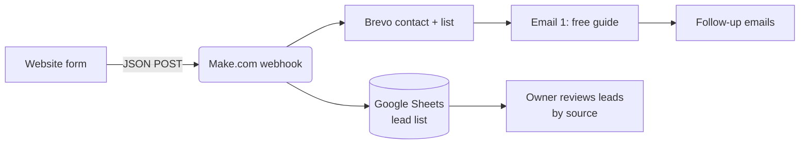

# Website Lead Capture → Google Sheets → Brevo follow-up

**A no-code lead system that catches every website enquiry, saves it to one sheet, tags where it came from, and starts an automatic email follow-up. It runs live on the AutoMinds AI Services website today.**

[See it working](https://autominds-ai.github.io/free-consultation.html) · [Book a free automation audit](https://calendly.com/eriksammy79/30min) · Built by [AutoMinds AI Services](https://autominds-ai.github.io)

---

## The problem
Small businesses get enquiries from their website, adverts, flyers and QR codes, then:
- leads sit in an inbox or a notebook and get forgotten,
- nobody knows which advert or sticker actually brought the lead,
- follow-up depends on someone remembering to send it.

## What this system does
1. A visitor fills in a short form (name, phone, email, business type, main challenge).
2. The browser sends the lead to a **Make.com webhook**.
3. Make.com **adds a row to Google Sheets**: one clean list the owner controls.
4. Make.com **adds the contact to Brevo**, which sends the free guide and starts a follow-up email sequence.
5. Every lead carries a **source tag** (`?src=flyer-lekki`, `?src=instagram`), so the owner can see which campaign works.

## What makes it useful
| Feature | Why it matters |
|---|---|
| Source tracking from the link (`?src=`), remembered across visits | Know which flyer, sticker or ad brought each lead |
| Business type pre-selected from the link (`?biz=real-estate`) | One form serves many niche campaigns |
| Phone numbers cleaned into international format | Ready for WhatsApp or SMS follow-up later |
| Email checked before sending | Fewer bounced follow-ups |
| `text/plain` POST | Works from a static site with no CORS preflight or backend |
| Owner keeps the data in their own Sheet and Brevo account | No lock-in |

## Tools
`Make.com` · `Google Sheets` · `Brevo` · plain HTML/JavaScript (works on GitHub Pages, WordPress or any site builder)

## Repo contents
| Path | What it is |
|---|---|
| [`src/lead-capture.js`](src/lead-capture.js) | Form logic: validation, source tracking, phone cleaning, webhook POST |
| [`src/lead-form.html`](src/lead-form.html) | Minimal demo form that uses the script |
| [`templates/lead-sheet-columns.csv`](templates/lead-sheet-columns.csv) | Google Sheet header row |
| [`docs/setup.md`](docs/setup.md) | Step-by-step build of the Make.com scenario |

## Run the demo
Open `src/lead-form.html` in a browser. Leave `WEBHOOK_URL` empty and the payload is printed to the console instead of being sent. Paste your own Make.com webhook URL to go live.

## Want this for your business?
AutoMinds AI Services builds lead capture, WhatsApp replies and follow-up systems for **real estate teams and medical/dental clinics**.
**[Book a free 30-minute automation audit →](https://calendly.com/eriksammy79/30min)**

---
MIT License. Use the template freely.
